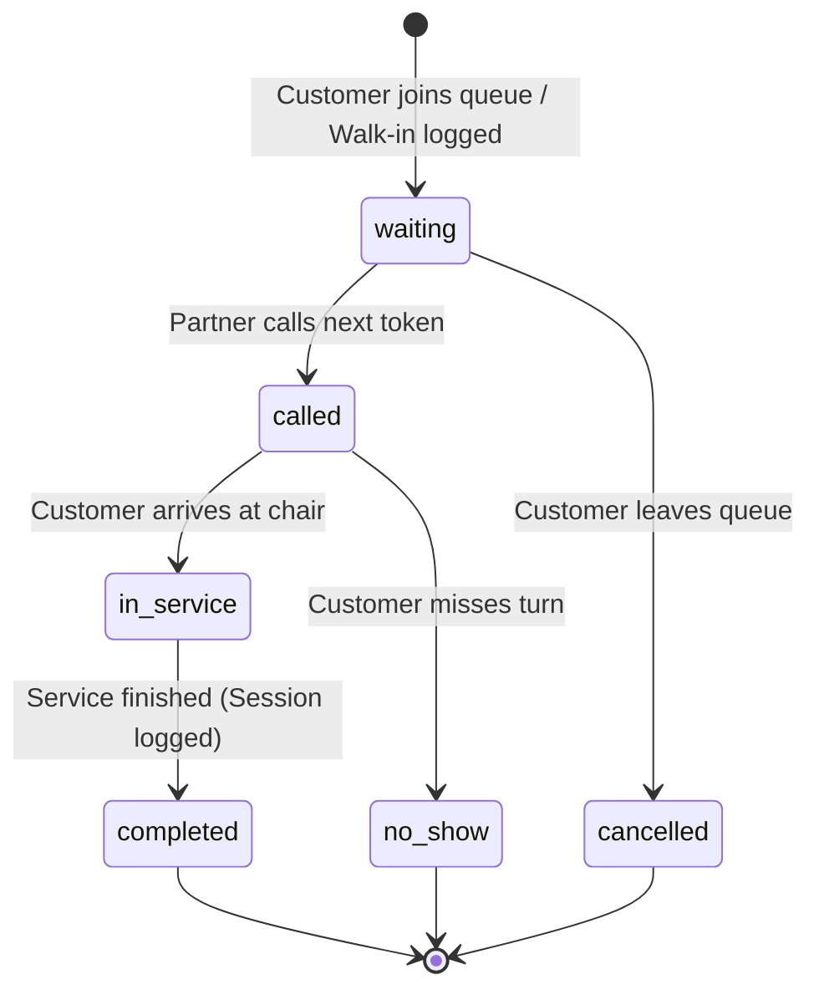

# KUMBHAKARAN (SLOON) – Comprehensive Platform & Engineering Guide

> **"Too lazy to call. Too smart to wait."**  
> An enterprise-grade multi-salon discovery and walk-in transparency ecosystem connecting customers with local salons through live waiting visibility, spatial map routing, real-time queuing, and partner management.

---

## Table of Contents
1. [Executive Summary & Core Philosophy](#1-executive-summary--core-philosophy)
2. [Monorepo Architecture & Directory Structure](#2-monorepo-architecture--directory-structure)
3. [User Roles & Permissions Matrix](#3-user-roles--permissions-matrix)
4. [Applications Breakdown](#4-applications-breakdown)
   - [Customer Web (`apps/customer-web`)](#customer-web-appscustomer-web)
   - [Partner Portal (`apps/partner-web`)](#partner-portal-appspartner-web)
   - [Admin Console (`apps/admin-web`)](#admin-console-appsadmin-web)
5. [Packages & Shared Libraries](#5-packages--shared-libraries)
   - [`packages/shared-types`](#packagesshared-types)
   - [`packages/ui`](#packagesui)
   - [`packages/api-client`](#packagesapi-client)
6. [Backend Architecture (`backend`)](#6-backend-architecture-backend)
   - [NestJS & Fastify Engine](#nestjs--fastify-engine)
   - [Database Schema & PostGIS](#database-schema--postgis)
   - [Real-Time WebSocket Sync](#real-time-websocket-sync)
7. [Core Technical Workflows](#7-core-technical-workflows)
   - [Live Walk-In Queue Lifecycle](#live-walk-in-queue-lifecycle)
   - [Hybrid Road Routing & Spatial Displacement](#hybrid-road-routing--spatial-displacement)
   - [Partner Onboarding & Multilingual Translation](#partner-onboarding--multilingual-translation)
   - [Customer Review System & 5-Criteria Breakdown](#customer-review-system--5-criteria-breakdown)
8. [Environment Configuration & Variables](#8-environment-configuration--variables)
9. [Local Development & Contribution Guide](#9-local-development--contribution-guide)
10. [Deployment & Production Runbook](#10-deployment--production-runbook)

---

## 1. Executive Summary & Core Philosophy

Kumbhakaran (branded as **SLOON**) solves the friction of traditional salon visits:
1. **Walk-In Transparency**: Rather than forcing rigid booking slots that salons rarely keep on time, SLOON provides live walk-in visibility—showing real-time queue length, estimated wait times, and barber availability.
2. **Hybrid Queue Model**: Customers can either walk in directly or join the live digital walk-in queue when nearby, receiving real-time tokens (`#01`, `#02`, etc.) with smart arrival assistance.
3. **Spatial Discovery & Routing**: Powered by PostGIS spatial queries, users discover nearby salons with exact driving routes along real streets, plus dashed off-road displacement connectors for unmapped alleys or indoor locations.

---

## 2. Monorepo Architecture & Directory Structure

The repository is structured as a high-performance **pnpm monorepo**:

```
KSalon/
├── apps/
│   ├── customer-web/       # Mobile-first customer exploration, queues, and studio details
│   ├── partner-web/        # Salon owner and barber management portal
│   └── admin-web/          # Platform superadmin moderation and analytics console
├── backend/
│   ├── prisma/             # Prisma schema, migrations, and seeds
│   └── src/
│       ├── modules/
│       │   ├── admin/      # Administrative audit logs and salon approvals
│       │   ├── auth/       # Google OAuth, JWT authentication, and sessions
│       │   ├── discovery/  # PostGIS spatial salon queries and geo-filtering
│       │   ├── health/     # System and database health diagnostic checks
│       │   └── salons/     # Salon CRUD, queues, staff, reviews, and WebSockets
│       ├── app.module.ts   # Root NestJS application module
│       └── main.ts         # Fastify application bootstrap & CORS setup
├── packages/
│   ├── api-client/         # Shared typed Axios/fetch API communication layer
│   ├── shared-types/       # Canonical TypeScript domain interfaces and DTOs
│   └── ui/                 # Shared UI components, Leaflet/Mapbox hybrid maps, routing
├── public/                 # Static brand assets, logos, and media
└── scripts/                # Database migrations, seeders, and setup automation
```

---

## 3. User Roles & Permissions Matrix

The platform models access across two levels: **Global Platform Roles** (stored on `User`) and **Salon-Specific Memberships** (stored on `SalonMember`).

| Role Identifier | Level | Description | Key Capabilities |
| :--- | :--- | :--- | :--- |
| **`CUSTOMER`** | Global (`User.role`) | End customer accessing the customer portal | • Browse salons by gender, category, and distance<br>• View real-time queue counts and estimated wait times<br>• Join live walk-in queues and receive digital tokens<br>• View in-app pinned maps with turn-by-turn road routing<br>• Save favourite studios and compare up to 4 salons<br>• Submit 5-criteria ratings and reviews with visit verification |
| **`PARTNER_OWNER`** | Salon (`SalonMember.role`) | Salon proprietor or general manager | • Register and configure salon details, photos, and loop video<br>• Set precise location coordinates using the interactive map pin<br>• Update opening hours, service catalogue, and pricing<br>• Manage staff/barbers, assign chairs, and set work shifts<br>• Live walk-in queue counter (`+1`, `-1`, pause, resume)<br>• Call next customer, start chair service, complete session<br>• View today's served count, daily revenue, and monthly trends<br>• Select preferred regional language for translated interface |
| **`PARTNER_STAFF`** | Salon (`SalonMember.role`) | Individual barber or stylist working at a salon | • Update personal chair availability (`AVAILABLE`, `BREAK`, `OFF`)<br>• View queued tickets assigned to their station<br>• Start and complete customer service sessions<br>• View personal service duration metrics and customer feedback |
| **`ADMIN`** | Global (`User.role`) | Kumbhakaran platform internal operator | • Verify and approve new salon partner registrations (`isVerified`)<br>• Suspend or activate salon listings (`status = 'active'/'suspended'`)<br>• Content moderation: flag, edit, or remove inappropriate reviews<br>• View platform-wide aggregate metrics (total salons, daily queues, revenue)<br>• Review immutable administrator audit logs (`AdminAuditLog`)<br>• Configure regional geofence thresholds (`smartQueueGeofenceRadiusMeters`) |

---

## 4. Applications Breakdown

### Customer Web (`apps/customer-web`)
* **Framework**: React 19 + TypeScript + Vite + Tailwind CSS v4.
* **Core Screens**:
  - `HomeScreen.tsx`: Gender toggle (`Men` / `Women`), search bar with category filters (`Hair`, `Beard`, `Combos`, etc.), nearby salons carousel, and quick walk-in highlights.
  - `ExploreScreen.tsx`: Infinite-scroll salon catalogue with distance indicators, live queue badges, and sorting.
  - `SalonDetailScreen.tsx`: 
    - **Top Navigation Tabs**: `[ Live Queue | Services | Showcase ]` placed above the salon hero card.
    - **Salon Card**: Cover carousel / loop video, verified badge, live token status, and **clickable location pin** to open in-app map.
    - **Bottom Navigation Tabs**: `[ Stylists | Reviews ]` placed below the salon card.
  - `MapScreen.tsx`: Full-screen interactive map displaying nearby salons, customer location pin, and road routing.
  - `SmartQueueAssist.tsx`: Real-time distance tracking and arrival guidance for queued customers.
  - `WriteReviewModal.tsx`: Detailed review modal capturing 5 granular criteria (Haircut Quality, Staff Behaviour, Cleanliness, Pricing, Overall Experience).

### Partner Portal (`apps/partner-web`)
* **Framework**: React 19 + TypeScript + Vite + Tailwind CSS v4.
* **Core Components**:
  - `PartnerPortal.tsx`: Main dashboard for salon operations:
    - Live Walk-In Counter: Instant `+1` / `-1` manual adjustments or full digital ticket queue management.
    - Queue Actions: Call Next, Mark In-Service, Complete Service, No-Show, Cancel.
    - Business Metrics: Customers served today, daily gross revenue, estimated wait calculations.
  - `SalonRegistrationWizard.tsx`: Multi-step onboarding flow for new salon owners:
    - Step 1: Basic info, owner contacts, salon type (`unisex`, `men`, `women`).
    - Step 2: Location details with `SalonLocationPicker.tsx` (drags pinpoint coordinates directly onto map).
    - Step 3: Service catalogue creation with category, duration, and pricing.
    - Step 4: Staff roster setup.
    - Step 5: Cover photo, loop video URL, and portfolio upload.
  - `i18n/`: Multilingual localization supporting major Indian languages (Hindi, Marathi, Gujarati, Bengali, Tamil, Telugu, Kannada, Malayalam, Punjabi, etc.).

### Admin Console (`apps/admin-web`)
* **Framework**: React 19 + TypeScript + Vite + Tailwind CSS v4.
* **Core Components**:
  - `AdminApp.tsx`: Central administrative interface:
    - Salon Verification Queue: Review submitted salon registrations and grant the "Verified Salon" badge.
    - Platform Directory: Search and filter all salons by city, locality, verification status, and health.
    - Moderation Feed: Review flagged customer ratings, comments, and partner replies.
    - Audit Trail: Inspect `AdminAuditLog` events tracking operator actions.

---

## 5. Packages & Shared Libraries

### `packages/shared-types`
Houses domain definitions consumed identically across frontend applications and backend services:
* `Salon`: Complete salon entity model including spatial coordinates, media gallery, queue telemetry, and ratings.
* `SalonQueueEntry`: Lifecycle states (`waiting`, `called`, `in_service`, `completed`, `cancelled`, `no_show`).
* `Service` & `Staff`: Services catalogue, categories, barber specializations, and chair availability.
* `Review` & `ReviewCriteria`: Granular multi-dimensional review structure.

### `packages/ui`
Shared component and rendering library:
* `SalonMapboxView.tsx`: Dual-engine interactive map component. Dynamically renders via Mapbox GL JS if token is configured, or automatically falls back to Leaflet + OpenStreetMap tiles.
* `routing.ts`: Routing intelligence engine. Computes driving travel using OSRM / Google Directions, detects user and shop off-road conditions, and generates hybrid 3-segment paths.
* `GoogleSignInButton.tsx`: Consistent Google OAuth authentication trigger.
* `NotificationToast.tsx`: Unified alert toasts.
* `QueueBadge.tsx`: Color-coded live queue status indicators (green = minimal wait, amber = moderate, red = heavy crowd).

### `packages/api-client`
* Standardized HTTP client with request signing, base URL resolution, and error serialization.

---

## 6. Backend Architecture (`backend`)

### NestJS & Fastify Engine
* **Engine**: Powered by **Fastify** for ultra-low latency and high-throughput API responses.
* **OpenAPI / Swagger**: Auto-generated interactive API docs available at `/api/docs`.
* **CORS**: Configured in `main.ts` to allow cross-origin requests from customer, partner, and admin domains.

### Database Schema & PostGIS
PostgreSQL running on Supabase with the **PostGIS** extension (`SRID 4326`):

1. **`salons`**:
   - `location`: PostGIS `geography(Point, 4326)` column.
   - Spatial indexing: `CREATE INDEX idx_salons_location_gist ON salons USING GIST (location);`
   - Spatial queries use parameterized raw SQL with `ST_DWithin` and `ST_Distance` (strictly **longitude first, latitude second**):
     ```sql
     SELECT id, name,
            ST_Distance(location, ST_SetSRID(ST_MakePoint($1, $2), 4326)::geography) / 1000 AS distance_km
     FROM salons
     WHERE ST_DWithin(location, ST_SetSRID(ST_MakePoint($1, $2), 4326)::geography, $3)
     ORDER BY distance_km ASC;
     ```
2. **`salon_queue_entries`**:
   - Manages live walk-in tickets.
   - Statuses: `'waiting'`, `'called'`, `'in_service'`, `'completed'`, `'skipped'`, `'cancelled'`, `'no_show'`.
   - Tracks timestamps: `joinedAt`, `calledAt`, `startedAt`, `servedAt`, `cancelledAt`.
3. **`service_sessions`**:
   - Historical records of completed services with duration and billed price for partner revenue analytics.
4. **`queue_events`**:
   - Immutable audit trail capturing every queue transition, actor ID, and timestamps.
5. **`users`** & **`salon_members`**:
   - Global user identities and salon-scoped role memberships (`PARTNER_OWNER` or `PARTNER_STAFF`).
6. **`admin_audit_logs`**:
   - Security audit logging for administrative actions.

### Real-Time WebSocket Sync
* Built with NestJS WebSockets (`Socket.IO`).
* Emits live events when queue counts change, tickets are called, or partner updates crowd status.
* Customer apps subscribe to their active salon room (`salon:{id}`) for instantaneous zero-refresh updates.

---

## 7. Core Technical Workflows

### Live Walk-In Queue Lifecycle



1. **Join Queue**: Customer clicks "Join Live Queue". A new `SalonQueueEntry` is created with a sequential token number (e.g. `#04`), position in line, and estimated wait time based on `activeBarbers` and `avgServiceTimeMinutes`.
2. **Real-Time Notification**: Socket event `queue:updated` broadcasts new queue state to all connected customers and partner dashboards.
3. **Chair Call**: Partner clicks "Call Next". Status moves to `called`. Smart queue assistance alerts the customer.
4. **In-Service & Completion**: Customer sits at chair (`in_service`). Upon completion, moving to `completed` creates a `ServiceSession`, updates today's customer count and revenue, and increments next in line.

---

### Hybrid Road Routing & Spatial Displacement

When navigating to a salon, a pure road route or pure straight line produces visual or functional inaccuracies:
- If a customer is in a shopping complex or off-road courtyard, road routing snaps to the street curb, creating a gap from GPS to route start.
- If a salon is inside a plaza, road route ends at the road access, not at the salon door.

**The SLOON Hybrid Engine (`routing.ts`)**:

```
[Customer GPS] 
      ┊  (Dashed connector: User off-road displacement)
[Road Access Point]
      ═══════════════> (Solid path with white casing: Real motorized road route)
[Road Exit Point]
      ┊  (Dashed connector: Shop setback displacement)
[Salon Pin]
```

- **Total Distance**: `userDisplacementMeters + roadMeters + shopDisplacementMeters`
- **Total Duration**: `walkingDuration + drivingDuration`
- **Off-Grid Fallback**: If no road network exists (e.g. remote terrain), cleanly falls back to direct displacement line with `isRoadRoute: false`.

---

### Partner Onboarding & Multilingual Translation

1. **Google OAuth**: Salon owner signs in with Google.
2. **Language Selection**: On initial sign-in, the partner opts into their preferred working language (Hindi, Marathi, Gujarati, Bengali, Tamil, Telugu, Kannada, Malayalam, Punjabi, or English).
3. **Salon Registration Wizard**:
   - Address and Geocoding: Interactive Leaflet/Mapbox location picker allows pinpoint accuracy for salon entry.
   - Services Catalogue & Staff: Defines service names, category tags, duration, and prices.
4. **Platform Verification**: Admin reviews registration in `apps/admin-web` and enables `isVerified = true`.

---

### Customer Review System & 5-Criteria Breakdown

Reviews are not just a single star score; they evaluate 5 distinct dimensions:
1. `haircutQuality` (1 to 5)
2. `staffBehaviour` (1 to 5)
3. `cleanliness` (1 to 5)
4. `pricing` (1 to 5)
5. `overallExperience` (1 to 5)

Verified visits carry the `verifiedVisit: true` badge if the customer checked in via the digital queue. Salon owners can publicly reply to reviews via `ownerReply`.

---

## 8. Environment Configuration & Variables

### Root / Backend (`backend/.env` or `.env.local`)
```env
PORT=3001
NODE_ENV=development

# Supabase PostgreSQL with PostGIS
DATABASE_URL=postgresql://postgres:[PASSWORD]@[HOST].supabase.co:5432/postgres

# Google OAuth Credentials
GOOGLE_CLIENT_ID=your-client-id.apps.googleusercontent.com
GOOGLE_CLIENT_SECRET=your-client-secret
JWT_SECRET=your-super-secret-jwt-key

# Optional Map Providers
VITE_MAPBOX_ACCESS_TOKEN=pk.eyJ...
VITE_GOOGLE_MAPS_API_KEY=AIzaSy...
```

### Frontend Applications (`apps/*/.env`)
```env
VITE_API_URL=http://localhost:3001/api/v1
VITE_WS_URL=http://localhost:3001
VITE_MAPBOX_ACCESS_TOKEN=pk.eyJ...
VITE_GOOGLE_MAPS_API_KEY=AIzaSy...
```

---

## 9. Local Development & Contribution Guide

### Step 1: Install Dependencies
```bash
# In the workspace root
pnpm install
```

### Step 2: Generate Database Client
```bash
cd backend
pnpm prisma:generate
```

### Step 3: Run Database Health Check
```bash
npm run backend:test:db
```
Verifies PostgreSQL connectivity, PostGIS extension, and GiST indexes.

### Step 4: Run Development Servers
* **All Services Concurrently**:
  ```bash
  pnpm dev
  ```
* **Individual Portals**:
  - Customer Web: `pnpm --filter @kumbhakaran/customer-web dev` (Port 5173)
  - Partner Web: `pnpm --filter @kumbhakaran/partner-web dev` (Port 5174)
  - Admin Web: `pnpm --filter @kumbhakaran/admin-web dev` (Port 5175)
  - Backend API: `pnpm --filter @kumbhakaran/backend start:dev` (Port 3001)

### Step 5: Building for Production
```bash
pnpm build
```

---

## 10. Deployment & Production Runbook

Refer to [`DEPLOYMENT.md`](file:///e:/KSalon/DEPLOYMENT.md) for full cloud configuration:
* **Backend**: Containerized via `backend/Dockerfile` and hosted on Railway, Render, or Google Cloud Run.
* **Database**: Supabase PostgreSQL with PostGIS spatial extension enabled.
* **Frontends**: Hosted on Vercel, Netlify, or Cloudflare Pages with single-page application fallback routing rules.

---
*Document Version: 2.4.0 • Maintained by the SLOON Engineering Team*
