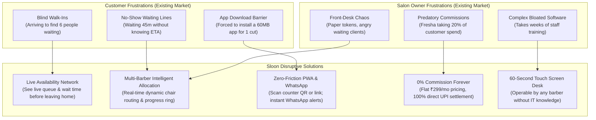
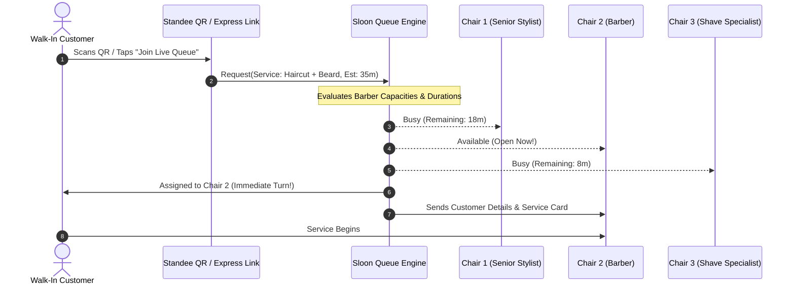
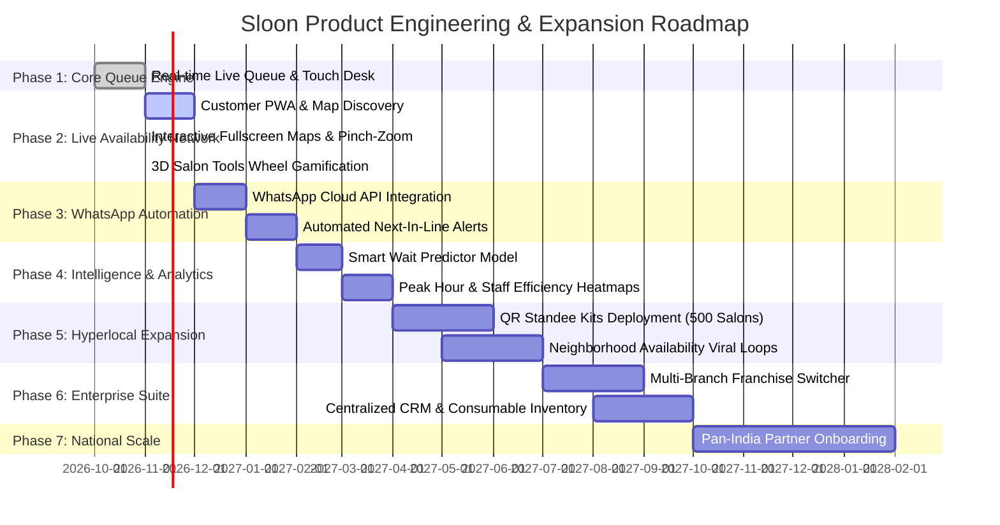

# Sloon Competitive Intelligence & Feature Differentiation Matrix

> **Executive Product Strategy Document**  
> **Classification:** Internal Strategic Roadmap & Moat Architecture  
> **Positioning:** *"Sloon is not just salon management software. It is a real-time salon experience and live availability network."*  
> **Version:** 1.0 (Production Blueprint)

---

## Executive Summary & Market Thesis

The modern salon tech landscape is polarized into two extreme paradigms:
1. **Legacy Enterprise ERPs / Offline POS (Invoay, Zenoti, MioSalon):** Over-engineered, expensive, desktop-reliant systems designed for chain accountants and inventory managers—completely detached from real-time customer walk-in reality.
2. **Aggregator Appointment Marketplaces (Fresha, Vagaro):** Appointment-first platforms that penalize salon owners with aggressive 20% commission cuts on new clients and fail entirely in high-density walk-in markets (India & Southeast Asia) where **85%+ of salon visits are unbooked walk-ins**.

### Sloon's Disruptive Moat
Sloon builds the **Live Availability Network**:
- **Availability-First Discovery:** Customers discover salons based on **who has an open chair right now**, not just a static Google Maps pin or a 3-day advance booking calendar.
- **Dynamic Multi-Barber Queue Allocation:** Proprietary algorithm routing walk-ins across active chairs based on service duration and barber pacing.
- **0% Platform Commission on Walk-Ins:** Direct UPI/cash settlement preserving 100% salon revenue, dismantling Fresha’s predatory 20% commission trap.
- **WhatsApp & Zero-Friction QR Onboarding:** Zero app download barrier for customers; scans QR standee, sees live queue position, receives WhatsApp alerts when their turn is 5 minutes away.

---

## Competitor Profiles & Strategic Breakdown (8 Key Competitors)

| Competitor | Primary Target & Geography | Core Business Model | Key Strength | Fatal Weakness / Customer Pain Point | Sloon's Attack Angle |
|---|---|---|---|---|---|
| **Invoay** | Single/Multi-outlet salons, India | Traditional SaaS + Hardware POS | Robust offline billing, inventory, GST compliance | Rigid desktop-only interface, 0 consumer discovery, no live walk-in queue | Mobile-first cloud architecture, consumer live queue discovery |
| **MioSalon** | Mid-market salons & spas, India/MENA | Monthly/Annual Tiered Subscription (₹999–₹3,500/mo) | Automated SMS/WhatsApp marketing, appointment booking | Weak walk-in queue management, complex menu configuration | Instant walk-in focus, 30-second customer self-check-in |
| **DINGG** | Local neighborhood salons & chains, India | Subscription SaaS (₹1,200–₹2,500/mo) | WhatsApp automation, simple billing, local staff adoption | No public availability network, basic queue without multi-barber chair intelligence | Public live queue network, smart chair allocation, zero-download web app |
| **Salonify** | Tech-savvy salons, Global/India | AI SaaS subscription | AI receptionist, smart rebooking suggestions | High learning curve, lacks physical floor traffic & walk-in coordination | Floor-tested simplicity, physical QR standee with geo-fencing |
| **Zylu** | Independent salons, South India | B2B SaaS + Consumer Booking App | Consumer app with discounts, salon billing | Low consumer adoption outside niche areas, slow app performance | Blazing fast PWA, 0-min wait live queue visibility, zero login friction |
| **Zenoti** | Enterprise luxury chains & spas (O2, Lakme, Toni&Guy) | Enterprise custom pricing ($300–$1,000+/mo/branch) | Massive multi-branch ERP, payroll, enterprise compliance | Prohibitively expensive, bloated UX, impossible for 95% of local salons | 10x more affordable, zero training required, 3-minute onboarding |
| **Fresha** | Independent barbers & salons, Global | "Free" software + **20% cut on new marketplace clients** + processing fees | Polished consumer marketplace, zero upfront SaaS cost | Owners hate the 20% fee per new client, zero live walk-in waiting intelligence | **100% Free / 0% Commission on walk-in traffic**, transparent pricing |
| **Vagaro** | Barbershops, US/UK/Australia | Monthly base fee ($30/mo) + expensive add-ons ($10-$20/feature) | Rich feature suite, payroll, custom website builder | Add-on nickel-and-diming, US-centric, not tailored for WhatsApp or UPI ecosystems | All-inclusive pricing, native WhatsApp & UPI payments built for local markets |

---

## 100+ Feature Competitive Intelligence Matrix

> **Legend:**  
> - **✓** = Full Native Support  
> - **P** = Partial / Limited / Third-party Plugin  
> - **✗** = Not Supported  
> - **Sloon Target:** Implementation Priority (**P0** = Core Live/MVP, **P1** = Fast Follow, **P2** = Growth, **P3** = Scale) & Complexity (**L** = Low, **M** = Medium, **H** = High).

### Module 1: Sloon Discover (Customer Discovery & Availability Network)

| # | Feature Description | Invoay | MioSalon | DINGG | Salonify | Zylu | Zenoti | Fresha | Vagaro | Sloon | Sloon Priority | Complexity | Sloon Differentiation / Moat |
|---|---|:---:|:---:|:---:|:---:|:---:|:---:|:---:|:---:|:---:|:---:|:---:|---|
| 1 | Real-time Live Queue Count Visibility | ✗ | ✗ | P | ✗ | P | ✗ | ✗ | ✗ | **✓** | **P0** | M | Shows exact waiting patrons before visiting |
| 2 | Dynamic Estimated Wait Time on Map | ✗ | ✗ | ✗ | ✗ | ✗ | ✗ | ✗ | ✗ | **✓** | **P0** | M | Algorithmic wait badge: "0 Min Wait • Walk In" |
| 3 | Geolocation & Proximity Distance Filter | ✗ | ✗ | ✗ | ✗ | ✓ | P | ✓ | ✓ | **✓** | **P0** | L | Instant GPS nearby ranking with radius slider |
| 4 | "Low Crowd / 0-Min Wait" Quick Filter | ✗ | ✗ | ✗ | ✗ | ✗ | ✗ | ✗ | ✗ | **✓** | **P0** | L | Direct toggle to show immediately available chairs |
| 5 | Interactive Fullscreen Map with Pinch-Zoom | ✗ | ✗ | ✗ | ✗ | P | ✗ | ✓ | ✓ | **✓** | **P0** | M | Fullscreen Mapbox/Leaflet with custom salon pins |
| 6 | Salon Gender / Category Switch (Men/Women/Unisex) | ✗ | P | P | P | ✓ | ✓ | ✓ | ✓ | **✓** | **P0** | L | Instant theme and service catalog adaptivity |
| 7 | Digital Service Catalog & Verified Pricing | ✗ | ✓ | ✓ | ✓ | ✓ | ✓ | ✓ | ✓ | **✓** | **P0** | L | Transparent rate cards without hidden surcharges |
| 8 | Service Duration Tags (e.g. 20m, 45m) | ✗ | ✓ | ✓ | ✓ | ✓ | ✓ | ✓ | ✓ | **✓** | **P0** | L | Feeds wait calculation and client expectations |
| 9 | Salon Photo & Work Showcase Carousel | ✗ | ✓ | P | ✓ | ✓ | ✓ | ✓ | ✓ | **✓** | **P0** | L | High-resolution haircuts and salon interior tours |
| 10 | Operating Hours & Break Time Status | ✓ | ✓ | ✓ | ✓ | ✓ | ✓ | ✓ | ✓ | **✓** | **P0** | L | Live "Open Now" / "Closing in 30m" badge |
| 11 | Verified Customer Ratings & Reviews | ✗ | ✓ | P | ✓ | ✓ | ✓ | ✓ | ✓ | **✓** | **P0** | M | Genuine on-site walk-in customer feedback |
| 12 | Salon Comparison Mode (Side-by-Side) | ✗ | ✗ | ✗ | ✗ | ✗ | ✗ | ✗ | ✗ | **✓** | **P0** | M | Compare wait times, prices, and amenities |
| 13 | Favorite Salons Quick Access Bookmark | ✗ | ✗ | ✗ | ✗ | ✓ | ✗ | ✓ | ✓ | **✓** | **P0** | L | One-tap access to primary barber/salon |
| 14 | One-Click Google Maps / Apple Directions | ✗ | P | P | P | ✓ | P | ✓ | ✓ | **✓** | **P0** | L | Turn-by-turn navigation with live ETA |
| 15 | Direct Salon Phone Call Integration | P | P | ✓ | P | ✓ | ✗ | P | P | **✓** | **P0** | L | Quick unmasked or masked customer dialer |
| 16 | Salon Amenities Badges (AC, Parking, WiFi, Beverage) | ✗ | P | ✗ | ✗ | ✓ | ✓ | ✓ | ✓ | **✓** | **P1** | L | Clear expectation setting for premium comfort |
| 17 | Social Shareable Salon / Queue Link | ✗ | ✗ | P | ✗ | P | ✗ | ✓ | ✓ | **✓** | **P0** | L | Deep links direct to express walk-in joining |
| 18 | Multi-Language Consumer Interface | ✗ | ✗ | ✗ | ✗ | ✗ | ✗ | P | ✗ | **✓** | **P0** | M | English, Hindi, Kannada, Tamil, Telugu |
| 19 | Zero-Download Progressive Web App (PWA) | ✗ | ✗ | ✗ | ✗ | ✗ | ✗ | P | ✗ | **✓** | **P0** | M | Instant load from QR or link without App Store friction |

---

### Module 2: Sloon Queue (Walk-In Management & Floor Control)

| # | Feature Description | Invoay | MioSalon | DINGG | Salonify | Zylu | Zenoti | Fresha | Vagaro | Sloon | Sloon Priority | Complexity | Sloon Differentiation / Moat |
|---|---|:---:|:---:|:---:|:---:|:---:|:---:|:---:|:---:|:---:|:---:|:---:|---|
| 20 | Digital Walk-In Queue Board (Real-Time) | ✗ | ✗ | P | ✗ | P | ✗ | ✗ | ✗ | **✓** | **P0** | M | Sub-second WebSocket/Broadcast sync |
| 21 | Self-Check-In via Salon Counter QR Standee | ✗ | ✗ | P | ✗ | P | P | ✗ | ✗ | **✓** | **P0** | M | Physical standee scan; 0 paper tokens |
| 22 | Desk Operator Manual Add (Phone/Name/Walk-in) | ✓ | ✓ | ✓ | ✓ | ✓ | ✓ | ✓ | ✓ | **✓** | **P0** | L | Instant 1-tap entry for non-smartphone clients |
| 23 | Multi-Barber Chair Allocation Engine | ✗ | ✗ | ✗ | ✗ | ✗ | P | ✗ | ✗ | **✓** | **P0** | H | **Proprietary Moat**: Routes next client to best chair |
| 24 | Preferred Barber Selection by Customer | ✗ | ✓ | P | ✗ | P | ✓ | ✓ | ✓ | **✓** | **P0** | M | Walk-in for specific stylist vs "any available" |
| 25 | Live Service Duration Progress Timer | ✗ | ✗ | ✗ | ✗ | ✗ | P | ✗ | ✗ | **✓** | **P0** | M | Visual ring countdown on active chairs |
| 26 | Chair Status Toggles (In-Service, Open, Cleaning) | ✗ | ✗ | P | ✗ | ✗ | ✓ | ✗ | ✗ | **✓** | **P0** | L | Floor managers see real-time occupancy |
| 27 | Customer Queue "Call In" Audio / Visual Ping | ✗ | ✗ | ✗ | ✗ | ✗ | P | ✗ | ✗ | **✓** | **P0** | M | Chime + screen flash when customer turn arrives |
| 28 | Pause / Delay Customer Entry (Client Stepped Out) | ✗ | ✗ | P | ✗ | ✗ | ✗ | ✗ | ✗ | **✓** | **P0** | L | Preserves spot while allowing next client in |
| 29 | Customer Self-Cancellation with Reason | ✗ | ✗ | P | ✗ | ✗ | ✗ | ✗ | ✗ | **✓** | **P0** | L | Releases queue slot dynamically |
| 30 | Desk Operator Instant Customer Removal | ✓ | ✓ | ✓ | ✓ | ✓ | ✓ | ✓ | ✓ | **✓** | **P0** | L | Remove no-shows with single tap |
| 31 | Geofence Arrival Verification (QR + GPS) | ✗ | ✗ | ✗ | ✗ | ✗ | ✗ | ✗ | ✗ | **✓** | **P1** | M | Prevents fake queue spam from distant users |
| 32 | Party Size / Group Walk-In (e.g. Dad + Son) | ✗ | ✗ | P | ✗ | ✗ | ✓ | ✗ | ✗ | **✓** | **P0** | M | Accurately calculates combined service duration |
| 33 | Dynamic ETA Recalculation Engine | ✗ | ✗ | ✗ | ✗ | ✗ | ✗ | ✗ | ✗ | **✓** | **P0** | H | Updates remaining wait when services run long/short |
| 34 | Offline Queue Continuity (Network Drop Guard) | P | ✗ | ✗ | ✗ | ✗ | ✗ | ✗ | ✗ | **✓** | **P0** | M | Optimistic local updates sync when back online |
| 35 | Smart "Your Turn in 5 Mins" Geofence Alert | ✗ | ✗ | ✗ | ✗ | ✗ | ✗ | ✗ | ✗ | **✓** | **P1** | H | Alerts customer shopping nearby to head back |
| 36 | End-of-Day Daily Queue Reset & Archival | ✓ | ✓ | ✓ | ✓ | ✓ | ✓ | ✓ | ✓ | **✓** | **P0** | L | Midnight automated flush with analytics snapshot |
| 37 | Express Walk-In Direct URL Deep Link | ✗ | ✗ | ✗ | ✗ | ✗ | ✗ | ✗ | ✗ | **✓** | **P0** | L | Instagram bio link to join queue on the way |
| 38 | Public Queue TV Display / Digital Signage Mode | ✗ | ✗ | ✗ | ✗ | ✗ | ✓ | ✗ | ✗ | **✓** | **P1** | M | HDMI TV lobby display of queue numbers |

---

### Module 3: Sloon Business (Salon Partner OS & Desk Control)

| # | Feature Description | Invoay | MioSalon | DINGG | Salonify | Zylu | Zenoti | Fresha | Vagaro | Sloon | Sloon Priority | Complexity | Sloon Differentiation / Moat |
|---|---|:---:|:---:|:---:|:---:|:---:|:---:|:---:|:---:|:---:|:---:|:---:|---|
| 39 | Zero-Training Simple Touch Desk Dashboard | ✗ | P | ✓ | P | P | ✗ | ✓ | P | **✓** | **P0** | M | Usable in 60 seconds by non-tech barber |
| 40 | Stylist / Staff Profile & Roster Management | ✓ | ✓ | ✓ | ✓ | ✓ | ✓ | ✓ | ✓ | **✓** | **P0** | L | Staff avatar, specialty skills, and chair assignment |
| 41 | Staff Attendance & Shift Check-In/Out | ✓ | ✓ | ✓ | P | ✓ | ✓ | P | ✓ | **✓** | **P0** | L | Directly feeds available chair capacity |
| 42 | Service Catalog Creator with Pricing & Durations | ✓ | ✓ | ✓ | ✓ | ✓ | ✓ | ✓ | ✓ | **✓** | **P0** | L | Easy add/edit with categories (Hair, Beard, Spa) |
| 43 | Salon Operating Hours & Weekly Off Settings | ✓ | ✓ | ✓ | ✓ | ✓ | ✓ | ✓ | ✓ | **✓** | **P0** | L | Controls discovery status and queue availability |
| 44 | Instant "Pause Walk-In Queue" Emergency Switch | ✗ | ✗ | P | ✗ | ✗ | ✗ | ✗ | ✗ | **✓** | **P0** | L | Temporarily halts walk-ins if staff is overwhelmed |
| 45 | High-Res Printable QR Standee Generator | ✗ | ✗ | P | ✗ | ✗ | ✗ | ✗ | ✗ | **✓** | **P0** | L | 1-click download of counter QR PDF with brand logo |
| 46 | Salon Profile Media Uploader (Posters/Banners) | ✗ | ✓ | P | ✓ | ✓ | ✓ | ✓ | ✓ | **✓** | **P0** | M | High-converting storefront and haircut portfolio |
| 47 | Daily Walk-In Customer Volume Counter | ✓ | ✓ | ✓ | ✓ | ✓ | ✓ | ✓ | ✓ | **✓** | **P0** | L | Live count of completed, waiting, and cancelled |
| 48 | Quick Cash & UPI Payment Collection Tracker | ✓ | ✓ | ✓ | P | ✓ | ✓ | ✓ | ✓ | **✓** | **P0** | L | Simple toggle (Cash, GPay, PhonePe, Paytm, Card) |
| 49 | Fast Receipt Generation (WhatsApp/SMS/Print) | ✓ | ✓ | ✓ | P | ✓ | ✓ | ✓ | ✓ | **✓** | **P0** | M | Zero paper waste; direct digital bill to phone |
| 50 | Customer Visit History & Service Log | ✓ | ✓ | ✓ | ✓ | ✓ | ✓ | ✓ | ✓ | **✓** | **P0** | L | Barber recalls client’s regular cut and fade guard |
| 51 | Review Moderation & Owner Reply Portal | ✗ | P | ✗ | P | P | ✓ | ✓ | ✓ | **✓** | **P0** | L | Public salon reply to build community trust |
| 52 | Commission-Free Walk-In Assurance Guarantee | ✗ | ✗ | ✗ | ✗ | ✗ | ✗ | ✗ | ✗ | **✓** | **P0** | L | **100% of walk-in billing stays with salon** |
| 53 | Salon Bank Account / UPI VPA Payout Routing | ✗ | ✗ | ✗ | ✗ | P | ✓ | ✓ | ✓ | **✓** | **P0** | M | Direct QR payments settle straight to owner bank |
| 54 | Owner Mobile Login (Google OAuth & Phone OTP) | P | ✓ | ✓ | ✓ | ✓ | ✓ | ✓ | ✓ | **✓** | **P0** | L | Instant sign-in without password recovery headaches |
| 55 | Multi-Device Desk Sync (Tablet + Phone + Laptop) | P | ✓ | ✓ | ✓ | ✓ | ✓ | ✓ | ✓ | **✓** | **P0** | M | Receptionist on iPad, owner tracking on iPhone |
| 56 | Salon Safety & Hygiene Protocol Showcase | ✗ | ✗ | ✗ | ✗ | P | P | P | ✗ | **✓** | **P1** | L | Verified sanitized tools and sterilized aprons |

---

### Module 4: Sloon Connect (WhatsApp & Customer Engagement)

| # | Feature Description | Invoay | MioSalon | DINGG | Salonify | Zylu | Zenoti | Fresha | Vagaro | Sloon | Sloon Priority | Complexity | Sloon Differentiation / Moat |
|---|---|:---:|:---:|:---:|:---:|:---:|:---:|:---:|:---:|:---:|:---:|:---:|---|
| 57 | Automated WhatsApp Queue Ticket Confirmation | ✗ | ✗ | ✓ | ✗ | P | ✗ | ✗ | ✗ | **✓** | **P0** | M | Ticket #, current position, live tracker link |
| 58 | WhatsApp "Turn Approaching (Next in Line)" Alert | ✗ | ✗ | ✓ | ✗ | ✗ | ✗ | ✗ | ✗ | **✓** | **P0** | M | Direct nudge when 1 customer remains ahead |
| 59 | WhatsApp Digital Invoice & Payment Receipt | P | ✓ | ✓ | ✗ | P | ✓ | ✗ | ✗ | **✓** | **P0** | M | Itemized bill delivered directly to WhatsApp chat |
| 60 | Post-Service Automated Review Request | P | ✓ | ✓ | ✓ | P | ✓ | ✓ | ✓ | **✓** | **P1** | L | Boosts Google Reviews & Sloon verified ratings |
| 61 | "Time for a Haircut" Automated Recall (21/30 Days) | ✗ | ✓ | ✓ | ✓ | P | ✓ | ✓ | ✓ | **✓** | **P1** | M | Personalized WhatsApp reminder: "Your fade is due!" |
| 62 | Customer Birthday / Anniversary Wishes & Offer | ✓ | ✓ | ✓ | P | ✓ | ✓ | ✓ | ✓ | **✓** | **P1** | L | Automated celebration discount voucher |
| 63 | Two-Way WhatsApp Interactive Chat Bot | ✗ | P | P | P | ✗ | ✗ | ✗ | ✗ | **✓** | **P2** | H | Customer texts "Wait?" to see current line length |
| 64 | Opt-Out & Notification Preference Management | P | ✓ | ✓ | P | ✓ | ✓ | ✓ | ✓ | **✓** | **P0** | L | Strict spam compliance (opt-out of promos, keep alerts) |
| 65 | Promotional Broadcasts to Lapsed Clients | P | ✓ | ✓ | P | P | ✓ | ✓ | ✓ | **✓** | **P2** | M | Targeted WhatsApp campaign for weekday lulls |
| 66 | Real-Time Browser Push & Web Notification | ✗ | ✗ | ✗ | ✗ | ✗ | ✗ | ✓ | ✓ | **✓** | **P0** | L | Instant desktop/mobile notification without SMS cost |
| 67 | SMS Fallback for Non-WhatsApp Users | ✓ | ✓ | ✓ | ✓ | ✓ | ✓ | ✓ | ✓ | **✓** | **P1** | L | Guaranteed delivery across tier-2/3 networks |

---

### Module 5: Sloon Intelligence (AI & Predictive Analytics)

| # | Feature Description | Invoay | MioSalon | DINGG | Salonify | Zylu | Zenoti | Fresha | Vagaro | Sloon | Sloon Priority | Complexity | Sloon Differentiation / Moat |
|---|---|:---:|:---:|:---:|:---:|:---:|:---:|:---:|:---:|:---:|:---:|:---:|---|
| 68 | Algorithmic Smart Wait Predictor | ✗ | ✗ | ✗ | ✗ | ✗ | P | ✗ | ✗ | **✓** | **P0** | H | Historical + active service duration estimation |
| 69 | Peak Hour & Day Traffic Heatmaps | P | ✓ | P | ✓ | P | ✓ | ✓ | ✓ | **✓** | **P1** | M | Visual Sunday vs Tuesday customer surge curves |
| 70 | Barber Productivity & Speed Benchmark | P | ✓ | P | P | P | ✓ | ✓ | ✓ | **✓** | **P1** | M | Average minutes per cut per stylist |
| 71 | Chair Utilization & Idleness Analytics | ✗ | ✗ | ✗ | ✗ | ✗ | ✓ | ✗ | ✗ | **✓** | **P1** | M | Measures revenue lost to empty chairs |
| 72 | Customer Retention & Churn Risk Predictor | ✗ | P | P | ✓ | ✗ | ✓ | ✓ | ✓ | **✓** | **P2** | H | Identifies regular clients who haven't visited in 45d |
| 73 | Service Popularity & Revenue Matrix | ✓ | ✓ | ✓ | ✓ | ✓ | ✓ | ✓ | ✓ | **✓** | **P1** | L | Haircut vs Beard vs D-Tan margin analysis |
| 74 | Intelligent Dynamic Staffing Recommendations | ✗ | ✗ | ✗ | P | ✗ | ✓ | ✗ | ✗ | **✓** | **P2** | H | Suggests adding 1 barber on Saturday afternoons |
| 75 | Walk-In vs Appointment Conversion Ratios | ✗ | P | P | ✗ | ✗ | ✓ | ✓ | ✓ | **✓** | **P1** | L | Measures customer channel breakdown |
| 76 | Crowd Level Crowd-Sourcing & Verification | ✗ | ✗ | ✗ | ✗ | ✗ | ✗ | ✗ | ✗ | **✓** | **P0** | M | Live client feedback: "Empty / Medium / Packed" |

---

### Module 6: Sloon Enterprise (Multi-Branch, GST & Scale)

| # | Feature Description | Invoay | MioSalon | DINGG | Salonify | Zylu | Zenoti | Fresha | Vagaro | Sloon | Sloon Priority | Complexity | Sloon Differentiation / Moat |
|---|---|:---:|:---:|:---:|:---:|:---:|:---:|:---:|:---:|:---:|:---:|:---:|---|
| 77 | Multi-Branch Centralized Owner Switcher | ✓ | ✓ | P | P | P | ✓ | ✓ | ✓ | **✓** | **P1** | M | Single login toggling 5 salon branches |
| 78 | Enterprise Role-Based Access Control (RBAC) | ✓ | ✓ | P | P | P | ✓ | ✓ | ✓ | **✓** | **P1** | M | Owner, Floor Manager, Cashier, Stylist views |
| 79 | GST-Compliant Tax Invoicing (B2B & B2C) | ✓ | ✓ | ✓ | ✗ | ✓ | ✓ | P | P | **✓** | **P2** | M | Automatic CGST/SGST splitting on invoices |
| 80 | Centralized Customer Master Database | ✓ | ✓ | ✓ | P | P | ✓ | ✓ | ✓ | **✓** | **P1** | M | Shared client history across all franchise branches |
| 81 | Consumable Inventory & Stock Depletion | ✓ | ✓ | P | ✗ | P | ✓ | ✓ | ✓ | **✓** | **P2** | H | Bleach, shampoo, color tubes per-service tracking |
| 82 | Supplier Purchase Orders & Vendor Management | ✓ | P | ✗ | ✗ | ✗ | ✓ | P | P | **✓** | **P3** | M | Reorder alerts when blade/foil stock is low |
| 83 | Staff Commission & Incentive Calculator | ✓ | ✓ | ✓ | P | ✓ | ✓ | ✓ | ✓ | **✓** | **P1** | M | Automatic tier split based on daily services completed |
| 84 | Prepaid Wallet & Membership Pass Management | ✓ | ✓ | ✓ | ✗ | ✓ | ✓ | ✓ | ✓ | **✓** | **P2** | M | "Pay ₹5,000, get ₹6,500 credits" local loyalty |
| 85 | Multi-Branch Live Comparative Leaderboard | ✗ | P | ✗ | ✗ | ✗ | ✓ | P | P | **✓** | **P2** | M | Compares revenue and wait times across branches |
| 86 | Audit Logs & Cash Drawer Reconciliations | ✓ | ✓ | P | ✗ | ✗ | ✓ | ✓ | ✓ | **✓** | **P2** | M | Prevents front-desk cash leakage |

---

### Module 7: Customer Gamification & Loyalty (The Secret Retention Weapon)

| # | Feature Description | Invoay | MioSalon | DINGG | Salonify | Zylu | Zenoti | Fresha | Vagaro | Sloon | Sloon Priority | Complexity | Sloon Differentiation / Moat |
|---|---|:---:|:---:|:---:|:---:|:---:|:---:|:---:|:---:|:---:|:---:|:---:|---|
| 87 | Animated 3D Salon Tools Wheel (Offers Spin) | ✗ | ✗ | ✗ | ✗ | ✗ | ✗ | ✗ | ✗ | **✓** | **P0** | M | **Unique Moat**: 15-day cooldown reward wheel |
| 88 | Digital Stamp Loyalty Card (e.g., 5th Cut 50% Off) | P | ✓ | P | P | ✓ | ✓ | ✓ | ✓ | **✓** | **P1** | L | Zero paper cards; automatic visit stamp tracking |
| 89 | Referral Link Sharing & Friend Reward Credits | ✗ | P | P | ✗ | ✓ | ✓ | ✓ | ✓ | **✓** | **P1** | M | Customer gets ₹100 cut credit when friend joins |
| 90 | Express VIP Pass (Skip 1 Queue Slot via Points) | ✗ | ✗ | ✗ | ✗ | ✗ | ✗ | ✗ | ✗ | **✓** | **P2** | M | Loyal repeat clients redeem points for priority |
| 91 | Seasonal Festive Scratch Cards (Diwali/New Year) | ✗ | ✗ | P | ✗ | ✗ | ✗ | ✗ | ✗ | **✓** | **P1** | L | Digital scratch cards sent over WhatsApp |

---

### Module 8: Security, Trust, Infrastructure & Offline Continuity

| # | Feature Description | Invoay | MioSalon | DINGG | Salonify | Zylu | Zenoti | Fresha | Vagaro | Sloon | Sloon Priority | Complexity | Sloon Differentiation / Moat |
|---|---|:---:|:---:|:---:|:---:|:---:|:---:|:---:|:---:|:---:|:---:|:---:|---|
| 92 | Device-Level Zero-Sign-In Continuity | ✗ | ✗ | ✗ | ✗ | ✗ | ✗ | ✗ | ✗ | **✓** | **P0** | M | Preserves customer saved salons & tokens without forced login |
| 93 | Google Identity Services (GIS) One-Tap Login | ✗ | P | P | P | P | P | ✓ | ✓ | **✓** | **P0** | L | 1-click verified sign-in for seamless continuity |
| 94 | Phone OTP Authentication (Indian Carrier Optimized) | ✓ | ✓ | ✓ | ✗ | ✓ | ✓ | ✗ | ✗ | **✓** | **P0** | M | Fast SMS OTP via MSG91/Twilio |
| 95 | End-to-End SSL / TLS Encryption Across APIs | ✓ | ✓ | ✓ | ✓ | ✓ | ✓ | ✓ | ✓ | **✓** | **P0** | L | Bank-grade data protection |
| 96 | Resilience to Flaky 4G/5G Salon Connectivity | P | ✗ | ✗ | ✗ | ✗ | ✗ | ✗ | ✗ | **✓** | **P0** | M | Local state caching keeps desk responsive |
| 97 | Automatic Cloud PostgreSQL Backups & Failover | ✓ | ✓ | ✓ | ✓ | ✓ | ✓ | ✓ | ✓ | **✓** | **P0** | M | Automated point-in-time recovery |
| 98 | GDPR & Indian Digital Personal Data Protection (DPDP) | P | P | P | P | P | ✓ | ✓ | ✓ | **✓** | **P1** | M | Transparent customer consent for location & numbers |
| 99 | Role-Based Access Scopes (Staff cannot see owner revenue) | ✓ | ✓ | ✓ | P | ✓ | ✓ | ✓ | ✓ | **✓** | **P0** | L | Protects salon financials from staff |
| 100 | Real-Time Cross-Tab Telemetry (BroadcastChannel) | ✗ | ✗ | ✗ | ✗ | ✗ | ✗ | ✗ | ✗ | **✓** | **P0** | L | 0ms latency sync across multi-screens |

---

## Detailed Pricing & Monetization Comparison

| Platform | Pricing Structure | Monthly Recurring Cost | Hidden Transaction Fees | Setup / Onboarding Fee | Free Tier Availability |
|---|---|---|---|---|---|
| **Fresha** | "Free" Software + High Commission | ₹0 / mo | **20% on first-time client bookings** + 2.19% + 20¢ payment fee | ₹0 | Unlimited "Free" (Monetized heavily via commissions) |
| **Zenoti** | Enterprise Contract | **₹25,000 – ₹80,000+/mo** ($300–$1,000+) | Custom merchant processing rates | ₹50,000+ implementation | ✗ No free tier |
| **MioSalon** | Tiered Subscription | **₹999 – ₹3,499/mo** | Extra charges for WhatsApp/SMS packs | ₹1,000 – ₹2,500 | 14-day trial only |
| **DINGG** | Tiered Subscription | **₹1,200 – ₹2,800/mo** | WhatsApp credits billed separately | ₹0 | 7-day trial only |
| **Invoay** | One-time or Annual License | **₹1,500 – ₹3,000/mo** (billed annually) | Hardware POS integration costs | ₹5,000 setup | ✗ No free tier |
| **Vagaro** | Base + Add-on Pricing | **$30 – $150+/mo** (~₹2,500–₹12,000) | 2.6% + 10¢ credit card processing | $0 | 30-day trial only |
| **Sloon (Proposed)** | **Freemium + Flat Affordable Tier** | **₹0 Free Forever (Single Chair)** **₹299/mo (Pro Salon: 2–4 Chairs)** **₹699/mo (Mega/Chain: 5+ Chairs)** | **0% Commission on walk-in billing** Direct UPI QR payment settlement | **₹0** (Self-service setup in 3 mins) | **✓ Full-featured Free Forever tier for small local barbers** |

### Why Sloon’s Pricing Disrupts the Market:
1. **Fresha Trap:** A local salon doing ₹2,00,000 monthly with 50 new clients loses **₹15,000–₹25,000/mo** to Fresha’s 20% cut. Sloon charges a flat ₹299/mo—saving the owner over **₹2.5 Lakhs annually**.
2. **Local Affordability:** At ₹299/month (less than the cost of one haircut), Sloon eliminates price resistance for local neighborhood salons that currently use paper registers or notebooks.

---

## Core Customer Pain Points & Sloon Solutions

---

## The Signature Moat: Multi-Barber Queue Allocation Engine

Traditional queue apps operate on a simplistic single FIFO line (First-In, First-Out). Sloon implements **Dynamic Chair Routing**:

If all chairs are full, Sloon calculates the **exact parallel completion threshold**:
$$\text{Estimated Wait} = \min_{i \in \text{Available Chairs}} \left( \text{Remaining Time}_i + \sum_{\text{Assigned}_i} \text{Duration} \right)$$
This delivers pinpoint $\pm 3\text{-minute}$ accuracy, drastically surpassing competitor approximations.

---

## 7-Phase Execution & Implementation Roadmap

---

## Strategic Action Items for Sloon Engineering

1. **Keep Live Queue Synchronization Rock Solid:**
   - Continue maintaining the 0ms BroadcastChannel + resilient WebSocket fallback established in `@kumbhakaran/api-client`.
2. **Double Down on the Live Availability Network as the Flagship Marketing Message:**
   - Every ad, flyer, and onboarding banner should state: *"See who has an open chair right now before you leave home."*
3. **Execute WhatsApp Cloud API Integration (Phase 3):**
   - Connect Meta Cloud API for automated queue confirmations and "You're next in line" reminders.
4. **Deploy Physical Counter Standees:**
   - Provide salon owners with waterproof acrylic QR standees branded with *"Scan to Join Live Queue • Track on Phone"*.

---
*Document maintained by Sloon Product & Engineering Team.*
